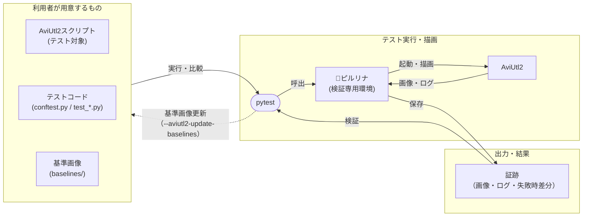

# 🐠ピルリナ（aviutl2-pyrrhulina）

pytestを用いてAviUtl2のスクリプトを実際に動かし、描画結果とログを検証するためのツールです。

検証専用の環境を作成します。既存プロジェクトには触れません。



## 前提

- Windows、AviUtl2(2.1.17)
- Python 3.12 以上
- テストの並列実行（pytest-xdist）: 未対応
- 検証は、実際にAviUtl2のウィンドウが一瞬表示されます。画面のない環境では動きません。

## 本ツールの利用

### 準備

[Releases](https://github.com/osakanamaki/aviutl2-pyrrhulina/releases)のwheelを追加します。

- 追加の例（どちらか1回）
  - `pip install https://github.com/osakanamaki/aviutl2-pyrrhulina/releases/download/v{バージョン}/aviutl2_pyrrhulina-{バージョン}-py3-none-any.whl`
  - `uv add --dev https://github.com/osakanamaki/aviutl2-pyrrhulina/releases/download/v{バージョン}/aviutl2_pyrrhulina-{バージョン}-py3-none-any.whl`
- Gitによるバージョン管理をしている場合、以下のフォルダを`.gitignore`します。
  - `.aviutl2-pyrrhulina/`

### テストの書き方

`conftest.py` で、検証するスクリプトのフォルダを指定します。

```python
from pathlib import Path

import pytest


@pytest.fixture(scope="session")
def aviutl2_scripts():
    return {"my-script-dev": Path(__file__).parent.parent / "script"}
```

テストでは、プロジェクトを組み立てて描画させます。
効果の名前と項目は、AviUtl2で保存した `.aup2` に書かれているものをそのまま使います。

```python
from pathlib import Path

from aviutl2_pyrrhulina import Effect, Project, TimelineObject

BASELINES = Path(__file__).parent / "baselines"  # 基準画像を置くフォルダ


def test_draws_bar(aviutl2):
    effect = Effect("連番まとめ", {"フレーム位置": "5"})
    project = Project(640, 360, [TimelineObject(0, 0, 10, [Effect("テキスト"), Effect("標準描画"), effect])])

    result = aviutl2.render(project, frames=[5])

    assert result.log_lines("[SCRIPT]")
    aviutl2.assert_matches(result.images[5], BASELINES / "bar_5.png")
```

- 描画したフレーム、使ったプロジェクト、AviUtl2のログは、テストの成否に関係なく `.aviutl2-pyrrhulina/evidence/<テスト名>/` に残ります。基準画像と比べたときは、今回の画像と差分も残ります。
- 基準画像が無い、または一致しないときは失敗します。
- 基準画像は自動では作りません。画像を目で確認してから `pytest --aviutl2-update-baselines` で書き込みます。
- 1つのテストで何度も描画したときは、最後の描画結果が残ります。
- AviUtl2を起動するテストには `aviutl2` マーカーが自動で付きます（`pytest -m "not aviutl2"` で除外）。

### 描画結果を目で確かめる

テストが終わると、`.aviutl2-pyrrhulina/evidence/index.html` ができます（パスはpytestの結果の最後に表示されます）。
ブラウザで開くと、今回実行したテストの描画結果を一覧できます。pytestの検査では判定しにくい絵柄の確認に使います。

- 失敗したテストが先頭に並びます。
- 基準画像と比べたテストは、一致したときも「基準画像／今回／差分」を並べて表示します。差分は、許容を超えた画素が白になります。
- 透明な部分は市松模様で表示されます。
- 2フレーム以上描画したテストは、動きを見られるようアニメーション（`frames.webp`）も表示します。フレーム番号の間隔どおりの時間で再生します。
- 載るのは今回実行したテストだけです。`-k` などで実行しなかったテストの古い証跡は載りません。

### 全フレームをまとめて基準画像と比べる（スナップショット）

`assert_snapshot` は、描画した全フレームを、テスト名から自動で決まる基準画像と比べます。
一度目で確かめた描画結果を正解として残し、スクリプトを変えた前後のデグレを見つけるのに使います。

```python
def test_draws_bar(aviutl2):
    result = aviutl2.render(project, frames=[0, 5, 10])
    aviutl2.assert_snapshot(result)  # 3フレームとも基準画像と比べる
```

- 基準画像は `<テストファイルのフォルダ>/baselines/<テストファイル名>/<テスト名>/frame_00005.png` に置かれます。場所は `aviutl2_baselines` fixture を上書きすると変えられます。
- 一致しないフレームがあっても途中で止めず、一致しなかったフレームをまとめて報告します。
- 1つのテストで何度も描画して比べるときは、`assert_snapshot(result, name="after_move")` のように名前を付けて区別します（`<テスト名>/after_move/` の下に置かれます）。
- 許容値は `tolerance` で指定します（`assert_matches` と同じ）。
- 基準画像の書き込みは `assert_matches` と同じく `--aviutl2-update-baselines` です。目で確かめたテストだけ書き込むときは、`-k` で絞ります。

```shell
pytest -k test_draws_bar --aviutl2-update-baselines
```

- テストの名前を変えたり消したりしても、古い基準画像は自動では消えません。
- AviUtl2本体を更新すると、スクリプトを変えていなくても描画結果が変わり、一致しなくなることがあります。

`assert_matches` は、比べる画像と基準画像のパスを自分で決めたいとき（特定のフレームだけ比べる、複数のテストで同じ基準画像を使うなど）に使います。

### 動くサムネイルを作る

AviUtl2で描画した結果から、[AviUtl2 Catalog](https://github.com/Neosku/aviutl2-catalog) 用の動くサムネイル（アニメーションWebP/GIF）を作ります。
テストではないので、pytestを使わずにコマンドで実行します。プロジェクトはAviUtl2で保存した `.aup2` を使います。

```shell
aviutl2-pyrrhulina-thumbnail demo.aup2 thumbnail.webp --script my-script-dev=script
```

| 項目 | 指定 | 既定 |
|---|---|---|
| 形式 | 出力ファイルの拡張子（`.webp` / `.gif`） | - |
| 大きさ | `--size`。縦横比を保って縮小し、正方形の中央に置きます | 206（カタログの推奨） |
| 長さ | `--seconds`。10秒まで | 3秒 |
| fps | `--fps`。プロジェクトのフレームレートを割り切れる値だけ（30fpsのプロジェクトなら 30・15・10 など） | 30 |
| 開始フレーム | `--start` | 0 |
| 背景 | `--background`（例: `#000000`） | 透明 |
| 画質 | `--quality`（WebPのみ、0〜100） | 80 |

- 細い線をきれいに残すため、プロジェクトは大きめの解像度で作って縮小させるのがおすすめです。
- 10MBを超えると警告が出ます。fps・長さ・画質を下げると小さくなります。
- GIFは透明を2段階（透明か不透明か）でしか表せず、半透明の部分は不透明になります。GIFでは `--background` の指定をおすすめします。
- 検証用の環境は `.aviutl2-pyrrhulina/` に作ります（`--work-dir` で変更できます）。
- Pythonから使うときは `make_thumbnail(environment, project, output_path, seconds=..., fps=...)` を呼びます（`environment` は `create_environment` で作ります）。

## 本ツールの開発

このリポジトリ自体を編集する場合

```shell
uv run task setup     # cloneした直後に1回
uv run task test      # AviUtl2を起動しないテスト
uv run task test:e2e  # AviUtl2を起動するテスト※
```

### ※追加の前提

`task test:e2e` は、検証用プラグイン（`src/aviutl2_pyrrhulina/_bin/aviutl2_pyrrhulina.aux2`）を先にビルドします。
ビルドにはg++（MinGW-w64）が必要です（`task test`のみの利用であればビルド不要）。

### リリース

`pyproject.toml` の `version` を上げてコミットし、同じ番号のタグをpushします。

```shell
git tag v{バージョン}
git push origin v{バージョン}
```

GitHub Actionsがプラグインをビルドし、wheelとプラグインをReleasesに置きます（`.github/workflows/release.yml`）。
タグと `version` が一致しないときは失敗します。
