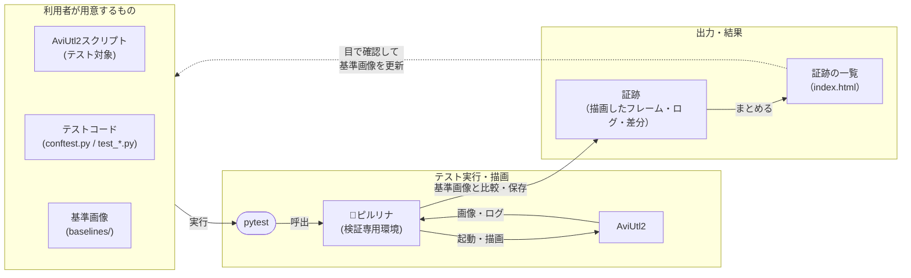

# 🐠ピルリナ（aviutl2-pyrrhulina）

[](https://github.com/osakanamaki/aviutl2-pyrrhulina/actions/workflows/ci.yml)
[](https://spring-fragrance.mints.ne.jp/aviutl/)
[](https://github.com/aviutl2/aviutl2_sdk_mirror)

pytestを用いてAviUtl2のスクリプトを実際に動かし、描画結果とログを検証するためのツールです。

検証専用の環境を作成します。普段使っているAviUtl2の設定やプロジェクトには触れません。



## できること

| 機能 | 説明 |
|---|---|
| [描画結果とログの検査](docs/testing.md) | プロジェクトを組み立ててAviUtl2で描画し、画像とログをpytestで検査します |
| [選択中のオブジェクトとして描画](docs/testing.md#選択中のオブジェクトとして描画するobjgetoptiongui) | オブジェクトを選択した状態のプレビューとして描画し、`obj.getoption("gui")` が `true` になる動きを検査します |
| [スナップショット](docs/testing.md#全フレームを基準画像と比べるスナップショット) | 描画した全フレームを、目で確かめて残した基準画像と比べ、デグレを見つけます |
| [証跡の一覧](docs/testing.md#描画結果を目で確かめる) | 描画結果・基準画像との差分・アニメーションを、ブラウザでまとめて確認できます |
| [プラグインと配布物の検査](docs/package.md) | プラグインを置いて検査したり、配布物をカタログのインストール手順どおりに置いて検査したりします。カタログに登録するハッシュ値（XXH3_128）も出せます |
| [動くサムネイル](docs/thumbnail.md) | 描画結果から、[AviUtl2 Catalog](https://github.com/Neosku/aviutl2-catalog) 用のアニメーションWebP/GIFを作ります |

使い方の細部（引数・fixture・作業フォルダ・困ったとき）は [リファレンス](docs/reference.md) にまとめています。

## 前提

- Windows
- AviUtl2 2.1.17 以上（検証済みのバージョンは上のバッジに示します）
- Python 3.12 以上
- 検証のたびに、実際にAviUtl2のウィンドウが一瞬表示されます。画面のない環境では動きません。
- テストの並列実行（pytest-xdist）には対応していません。並列で実行すると、AviUtl2を起動するテストはエラーになります。

## インストール

[Releases](https://github.com/osakanamaki/aviutl2-pyrrhulina/releases/latest) の最新版の Assets にある wheel（`.whl`）のリンクをコピーし、そのURLを使って追加します。

```shell
# uv の場合
uv add --dev {wheel の URL}

# pip の場合
pip install {wheel の URL}
```

Gitで管理している場合は、作業フォルダを `.gitignore` に追加します。

```gitignore
.aviutl2-pyrrhulina/
```

AviUtl2は `C:\Program Files\AviUtl2` にあるものを使います。別の場所にあるときは、環境変数 `AVIUTL2_APP` か pytest の `--aviutl2-app` で指定します。

## 最短手順

次のようなフォルダ構成で、`script/my-object.obj2` を検査する例です。

```text
my-script/
├─ script/
│  └─ my-object.obj2
└─ tests/
   ├─ conftest.py
   └─ test_my_object.py
```

**1. 検査するスクリプトのフォルダを指定します**（`tests/conftest.py`）

```python
from pathlib import Path

import pytest


@pytest.fixture(scope="session")
def aviutl2_scripts():
    # AviUtl2 の Script フォルダの下に「my-script-dev」という名前で置かれます。
    return {"my-script-dev": Path(__file__).parent.parent / "script"}
```

**2. テストを書きます**（`tests/test_my_object.py`）

```python
from aviutl2_pyrrhulina import Effect, Project, TimelineObject


def test_my_object(aviutl2):
    # レイヤー0、0〜9フレームに、my-object と標準描画を持つオブジェクトを置く。
    my_object = TimelineObject(0, 0, 9, [Effect("my-object"), Effect("標準描画")])
    project = Project(320, 240, [my_object])

    result = aviutl2.render(project, frames=[0, 9])

    aviutl2.assert_snapshot(result)
```

**3. 実行します**

```shell
pytest
```

最初は基準画像が無いので失敗します。

**4. 描画結果を目で確かめます**

pytestの結果の最後に表示される `.aviutl2-pyrrhulina/evidence/index.html` をブラウザで開き、描画結果が正しいか確認します。

**5. 正しければ、基準画像として書き込みます**

```shell
pytest --aviutl2-update-baselines
```

`tests/baselines/` に基準画像ができます。これもGitで管理します。
以降は `pytest` を実行するたびに、描画結果が基準画像と一致するか検査されます。

続きは [テストの書き方](docs/testing.md) を参照してください。

## ドキュメント

| ページ | 内容 |
|---|---|
| [テストの書き方](docs/testing.md) | プロジェクトの組み立て、ログの検査、スナップショット、証跡の一覧 |
| [プラグインと配布物の検査](docs/package.md) | プラグインの配置、配布物をインストール手順どおりに置いた検査、XXH3_128 |
| [動くサムネイル](docs/thumbnail.md) | カタログ用のアニメーションWebP/GIFの作り方 |
| [リファレンス](docs/reference.md) | API・fixture・オプションの一覧、作業フォルダ、困ったとき |
| [開発](docs/development.md) | このリポジトリ自体の開発・ビルド・リリース |

## ライセンス

[MIT](LICENSE)
